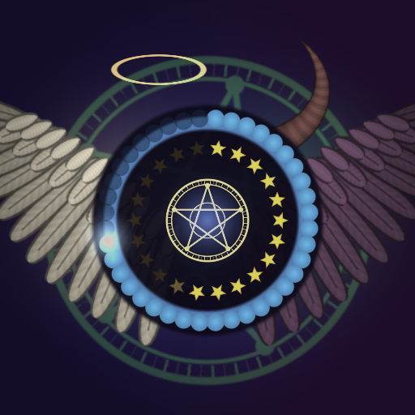

<p align="center">
  
</p>

<h1 align="center">ManaSigil</h1>

<p align="center">
  <b>Mana ring + five-second rule + mana tick timer in one – fully customizable with class themes.</b><br>
  <i>Mana-Ring + 5-Sekunden-Regel + Mana-Tick-Timer in einem – frei gestaltbar mit Klassen-Themen.</i>
</p>

<p align="center">
  <a href="https://www.curseforge.com/projects/1812997">CurseForge</a> ·
  World of Warcraft: Forever (Interface 16001)
</p>

---

## Features

- **Three display modes** – Ring, Pie or Bar
- **MP5 display** – your mana regeneration per 5 seconds, normal and during the five-second rule
- **Color gradient & low mana warning** – numbers go green → yellow → red; below a threshold you choose (percent or mana) they blink and a warning sound plays
- **Bar colors** – the mana bar and the timer bar each get their own fixed color or their own color gradient, independent of the numbers
- **Edit mode with a green sandbox** – press "Edit arrangement" (or `/msig edit`), drag every part with the mouse, press "Save arrangement"
- **Visual effects** – pulsing, floating, rotating, flickering and the tick flash can each be switched on and off
- **Mana ring (outer)** – current mana as a glowing ring with a spark at the fill edge
- **Five-second rule (inner ring)** – drains over 5 seconds after you spend mana, with a countdown
- **Mana tick timer** – shows the 2-second regen cycle and flashes `+amount` on every tick
- **Class themes**, chosen automatically:

  | Theme | Default for |
  |---|---|
  | Angel Wings – wings, halo, floating | Priest |
  | Demon Pact – horns, rotating fel sigil, flames & skulls | Warlock |
  | Arcane Runes – counter-rotating rune circles | Mage |
  | Grove of Nature – leaves | Druid |
  | Holy Light – rotating sun rays | Paladin |
  | Stormcaller – flickering lightning | Shaman |
  | Wilderness – feathers | Hunter |
  | Shadow Wings – violet wings | – |
  | Classic – just the ring | – |

- **Design everything yourself:** 11 symbols per ring (dot, orb, ring, diamond, star, square, heart, flame, cross, skull, leaf) or a solid circle, all sizes, 18 colors, background shape, 9 toggleable modules, live preview
- **Minimap button:** left-click on/off, right-click options, drag to move
- **English & German** – follows your game client language automatically
- No libraries, lightweight, settings saved per character

## Installation

1. Download the latest ZIP from [Releases](../../releases) or CurseForge.
2. Extract it to `World of Warcraft/_forever_/Interface/AddOns/` – the `.toc` must end up at `AddOns/ManaSigil/ManaSigil.toc`.
3. Start the game or type `/reload`.

## Commands

| Command | Function |
|---|---|
| `/msig`, `/manasigil` | Open options |
| `/msig toggle` · `on` · `off` | Display on/off |
| `/msig mode ring` · `pie` · `bar` | Display mode |
| `/msig debug` | Show mana/MP5 values for troubleshooting |
| `/msig minimap` | Show/hide minimap button |
| `/msig lock` · `unlock` | Lock / unlock position |
| `/msig theme <name>` | `angel`, `demon`, `arcane`, `nature`, `holy`, `storm`, `wild`, `shadow`, `classic`, `auto` |
| `/msig test` | Start the five-second rule as a test |
| `/msig reset` | Reset position |

## Custom themes

Add a `Register("mytheme", { ... })` block to [`Themes.lua`](Themes.lua). All fields (colors, symbols, decoration elements with position, size, mirroring, rotation, floating, pulsing, flicker) are documented at the top of the file.

## Project structure

| Path | Content |
|---|---|
| `ManaSigil.toc` | Addon manifest |
| `Locale.lua` | Translations (enUS, deDE) |
| `Core.lua` | Namespace, saved variables, events, slash commands |
| `Themes.lua` | Theme definitions |
| `Tracker.lua` | Five-second rule and mana tick logic |
| `Display.lua` | Rings, background, decoration, text, animations |
| `Options.lua` | Options panel (Game Menu → Options → AddOns) |
| `Minimap.lua` | Minimap button |
| `Media/` | Textures (generated, white/greyscale, tinted in game) |
| `tools/gen_media.py` | Regenerates all textures (pure Python, no dependencies) |
| `tools/logo.py` | Renders `docs/logo.png` from the textures |
| `tools/smoke_test.lua` | Smoke test with a mocked WoW API (Lua 5.1) |

### Development

```bash
# Regenerate textures (writes Media/*.tga, previews to a temp folder)
python tools/gen_media.py Media preview

# Smoke test (Lua 5.1)
lua5.1 tools/smoke_test.lua .
```

## Releases

Pushing a tag like `v1.0.1` builds a clean addon ZIP via GitHub Actions and attaches it to a GitHub release. Bump `## Version:` in `ManaSigil.toc` and add an entry to [`CHANGELOG.md`](CHANGELOG.md) first.

## Credits

Inspired by the classic addons ManaCircle and FiveSecondRule – completely rewritten with its own code and artwork.

## License

[MIT](LICENSE)
